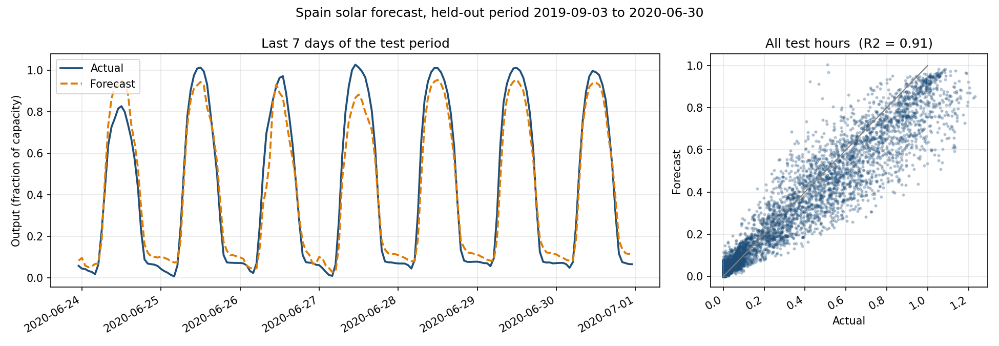

# AI Solar Forecast

Forecasts how much electricity solar panels produce from hourly weather data, using gradient boosting (XGBoost).
Built with AI as a coding partner.



## Results (Spain, held-out test period 2019-09 to 2020-06)

| Metric | Value |
|---|---|
| R2 | 0.91 |
| RMSE (fraction of capacity) | 0.099 |
| MAE (fraction of capacity) | 0.058 |
| MAPE (hours with output > 10% of capacity) | 22% |

The data is split chronologically (70% train / 15% validation / 15% test), so the model is always tested on the future it never saw.

## How it works

1. Hourly solar generation and hourly weather (solar radiation, cloud cover, temperature, wind) are merged.
2. Output is normalized by installed capacity ("capacity factor"), so countries of different sizes are comparable.
3. Features: weather, hour of day and day of year (as sine/cosine), and country context (latitude, average sunlight).
4. One XGBoost model is trained on the combined data and evaluated on the final part of each country's timeline.

## Multi-country design

Each country is one entry in `country_config.py` (location, capacity, data format), and data loaders are swappable adapters in `data_loading.py`.
`leave_one_country_out.py` trains on all countries except one and tests on the country the model never saw, to check that it generalizes.

**Current status:** only Spain's data is included, so the model is trained and evaluated on Spain.
The leave-one-country-out test needs at least two countries and has not been run yet.

## Run it

```
pip install -r requirements.txt
python train_model.py        # trains, prints metrics, saves model_evaluation.png and xgb_solar_model.json
python plot_forecast.py      # saves forecast_vs_actual.png
```

## Files

```
country_config.py          countries and their metadata
data_loading.py            raw data readers
build_dataset.py           merges everything into one dataset with features
train_model.py             trains and evaluates the model
plot_forecast.py           forecast vs actual figure
leave_one_country_out.py   generalization test (needs 2+ countries)
data/                      Spain generation and weather files
```

## Limitations and next steps

- Only one country so far; adding countries and running the leave-one-country-out test is the main next step.
- Installed capacity is estimated from the generation series itself (trailing one-year 99.5th percentile),
  because the hand-entered capacity table did not match the generation data. Real capacity data would be better.
- With a single country, the country-context features (latitude, average sunlight) carry no signal.
- No hyperparameter search yet.

See `CHANGES.md` for the fixes made to the first version.
